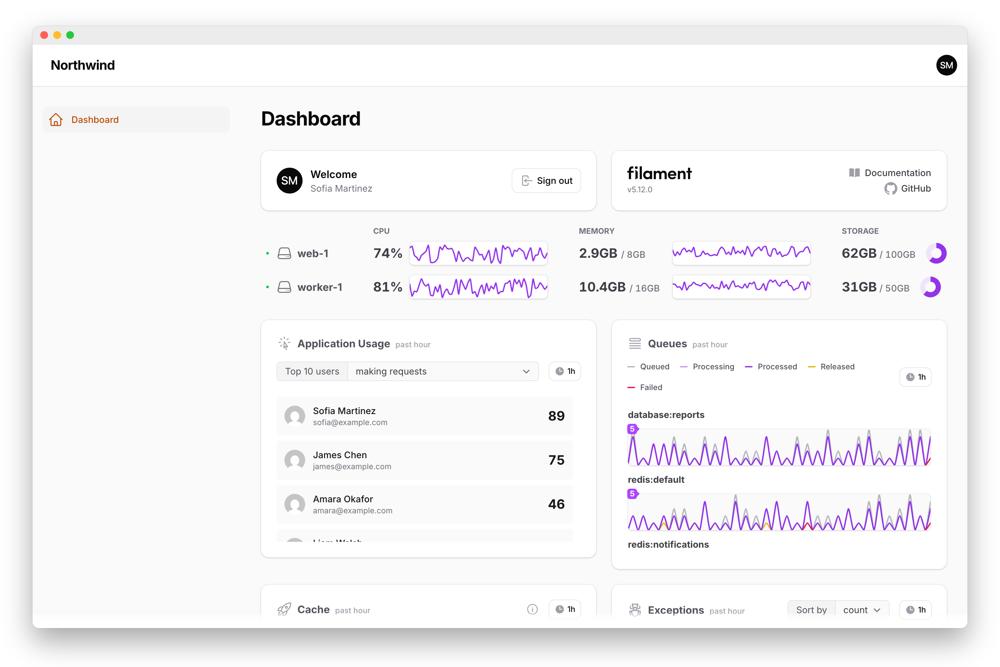
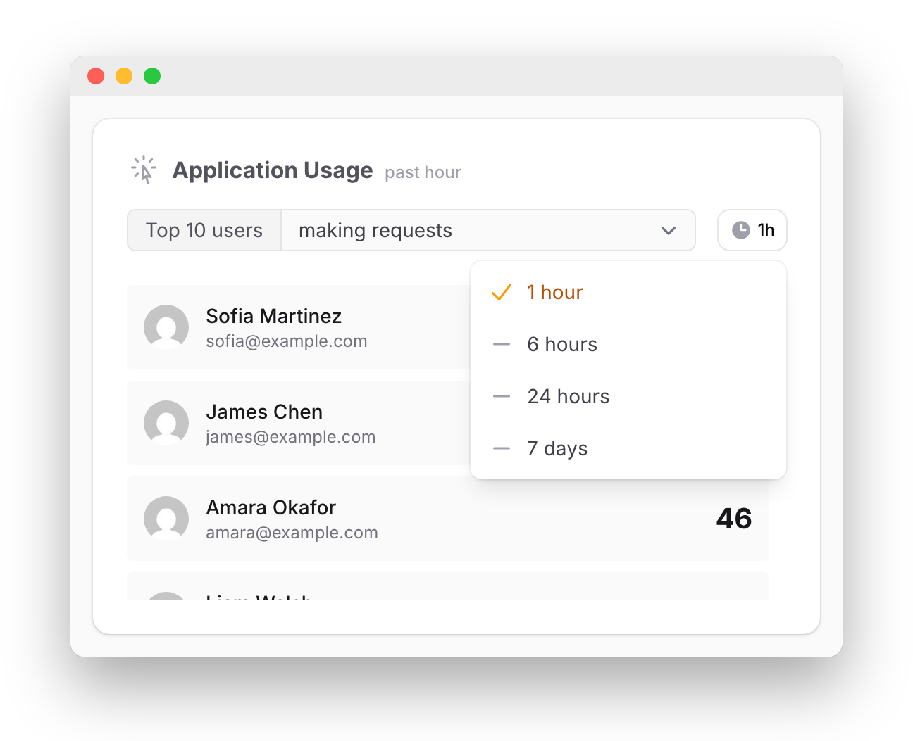

# Filament Pulse Widgets

[](https://packagist.org/packages/kfriars/filament-pulse-widgets)
[](https://github.com/kfriars/filament-pulse-widgets/actions/workflows/ci.yml)
[](https://github.com/kfriars/filament-pulse-widgets/blob/master/LICENSE.md)

Laravel Pulse cards as Filament v5 widgets, alongside your panel's own widgets.

<picture>
  <source media="(prefers-color-scheme: dark)" srcset="https://raw.githubusercontent.com/kfriars/filament-pulse-widgets/master/art/dashboard-dark.png">
  
</picture>

Every first-party Pulse card ships as a ready-made **Pulse widget**, and any custom Pulse card can become one. A Pulse widget renders the real Pulse card, unchanged, styled to match your panel in light and dark mode, with its own period selector. It runs on official [`laravel/pulse`](https://github.com/laravel/pulse), not a fork, and needs no custom Filament theme.

## Requirements

- PHP 8.3+
- Laravel 12 or 13
- Filament 5.12+
- Laravel Pulse 1.11+, [installed and recording](https://laravel.com/docs/pulse#installation)

## Installation

1. Install the package:

   ```bash
   composer require kfriars/filament-pulse-widgets
   ```

2. Add the plugin to every panel that shows Pulse widgets:

   ```php
   use Kfriars\FilamentPulseWidgets\FilamentPulseWidgetsPlugin;

   public function panel(Panel $panel): Panel
   {
       return $panel
           // ...
           ->plugin(FilamentPulseWidgetsPlugin::make());
   }
   ```

   The plugin places no Pulse widgets itself. It loads the Pulse widget stylesheet and Pulse's JavaScript on its panel only, and holds the panel's [access rules](#who-can-see-pulse-widgets).

3. Publish the stylesheet and Pulse's JavaScript:

   ```bash
   php artisan filament:assets
   ```

   Filament's installer adds `php artisan filament:upgrade` to your `composer.json`'s `post-autoload-dump` scripts, and that runs `filament:assets` for you on every `composer install` and `composer update`.

> [!NOTE]
> Pulse's JavaScript loads as a module. If `ASSET_URL` points at another origin, such as a CDN, that origin must send CORS headers, as it already must for Vite's scripts.

## Placing Pulse widgets

A Pulse widget is a Filament widget, so it goes wherever a widget goes: a panel's `->widgets()`, a dashboard's `getWidgets()`, or a page's header or footer widgets.

```php
use Kfriars\FilamentPulseWidgets\Widgets\PulseServersWidget;
use Kfriars\FilamentPulseWidgets\Widgets\PulseSlowQueriesWidget;
use Kfriars\FilamentPulseWidgets\Widgets\PulseUsageWidget;

->widgets([
    PulseServersWidget::class,
    PulseUsageWidget::class,
    PulseSlowQueriesWidget::class,
])
```

### The ready-made Pulse widgets

| Pulse widget | Pulse card | Its own options |
| --- | --- | --- |
| `PulseServersWidget` | Servers | `->ignoreAfter('3 hours')`, `->sortBy('cpu_current')`, `->sortDirection('desc')` |
| `PulseUsageWidget` | Application Usage | `->type('requests')`, `'slow_requests'` or `'jobs'` |
| `PulseQueuesWidget` | Queues | |
| `PulseCacheWidget` | Cache | |
| `PulseExceptionsWidget` | Exceptions | |
| `PulseSlowQueriesWidget` | Slow Queries | `->withoutHighlighting()` |
| `PulseSlowRequestsWidget` | Slow Requests | |
| `PulseSlowJobsWidget` | Slow Jobs | |
| `PulseSlowOutgoingRequestsWidget` | Slow Outgoing Requests | |

Each of these sets the Pulse card's prop of the same name, and unset, the Pulse card keeps its default: without `->type()`, for example, the Application Usage card shows its own dropdown. Pulse's docs on [customizing its dashboard](https://laravel.com/docs/pulse#dashboard-customization) explain `ignoreAfter`, `type` and `withoutHighlighting`. `->sortBy()` takes one of the Servers card's values, such as `name`, `cpu_current` or `memory_current`, and `->sortDirection()` takes `asc` or `desc`.

Servers and Slow Queries span the full width by default, and the rest take one column.

### Options

Every option is set on `make()`, so a page can hold several placements of the same Pulse widget, each with its own options:

```php
use Kfriars\FilamentPulseWidgets\PulsePeriod;

PulseUsageWidget::make()->type('requests'),
PulseUsageWidget::make()->type('jobs')->period(PulsePeriod::SevenDays),
```

| Option | What it does |
| --- | --- |
| `->period(PulsePeriod::SixHours)` | The period the Pulse widget starts at, on every page load. Default: `PulsePeriod::OneHour`. |
| `->withoutPeriodSelector()` | Hides the [period selector](#the-period-selector), so the Pulse widget always shows the period it was placed with. |
| `->columnSpan(2)` | The placement's column span, which takes what Filament's `$columnSpan` takes. |
| `->expand()` | Grows the Pulse card to fit its content, instead of scrolling it. The Servers card doesn't scroll. |
| `->cardProperties(['orderBy' => 'latest'])` | Props passed straight to the Pulse card, for anything without its own option, such as the Exceptions card's sort. Every other option, and the period, wins over them. |
| `->authorize('ability')` | Gate abilities the user also needs. See [who can see Pulse widgets](#who-can-see-pulse-widgets). |
| `->visible()` / `->hidden()` | Shows or hides the placement, decided once while the page renders. For layout, not security. |

### Your own Pulse cards

A [custom Pulse card](https://laravel.com/docs/pulse#custom-cards), one that extends Pulse's `Card`, needs no class of its own. Give `->card()` its class, or the name Livewire knows it by:

```php
use App\Livewire\Pulse\TopSellers;
use Kfriars\FilamentPulseWidgets\Widgets\PulseWidget;

PulseWidget::make()->card(TopSellers::class),
```

For a Pulse widget class of its own, to give it its own [access rule](#who-can-see-pulse-widgets) or to place it by name, extend `PulseWidget` and set `$card`:

```php
use App\Livewire\Pulse\TopSellers;
use Kfriars\FilamentPulseWidgets\Widgets\PulseWidget;

class TopSellersWidget extends PulseWidget
{
    public string $card = TopSellers::class;
}
```

A custom Pulse card's own `css()` arrives with its Pulse widget. See [styling custom Pulse cards](#styling-custom-pulse-cards).

## Who can see Pulse widgets

By default, whoever passes Pulse's `viewPulse` gate, the same gate that guards Pulse's dashboard.

> [!WARNING]
> Pulse's default `viewPulse` gate allows only the `local` environment. **In production, nobody sees Pulse widgets until you [define `viewPulse`](https://laravel.com/docs/pulse#dashboard-authorization)** or set one of the rules below.

> [!WARNING]
> Pulse widgets show **the whole app's** data: every user's requests, every slow query and every exception. Panels with tenancy are no exception. Only let in users who may see all of it.

Set a rule for the panel, which replaces `viewPulse` there, so you can show Pulse widgets without opening up Pulse's dashboard. A closure is given the panel's signed-in user:

```php
FilamentPulseWidgetsPlugin::make()
    ->authorize(fn (?User $user): bool => $user?->isAdmin() ?? false)
```

Or set one for particular Pulse widget classes. It applies to exactly those classes, not their subclasses, and wins over the panel's rule:

```php
FilamentPulseWidgetsPlugin::make()
    ->authorize(fn (?User $user): bool => $user?->isAdmin() ?? false)
    ->authorize(fn (?User $user): bool => $user?->isSupport() ?? false, widgets: [
        PulseExceptionsWidget::class,
    ])
```

A Pulse widget class of your own can override `canView()` instead, which replaces both:

```php
use Filament\Facades\Filament;

class TopSellersWidget extends PulseWidget
{
    public string $card = TopSellers::class;

    public static function canView(): bool
    {
        return Filament::auth()->user()?->can('view-sales') ?? false;
    }
}
```

A placement can narrow its class's rule with gate abilities, every one of which the user needs. They're checked again on every request its Pulse card makes:

```php
PulseSlowQueriesWidget::make()->authorize('view-database-internals'),
PulseExceptionsWidget::make()->authorize(['view-errors', 'view-stack-traces']),
```

Users who aren't allowed don't see the Pulse widget at all. If they lose access while the page is open, the Pulse card's next poll gets a 403.

A placement's `->visible()` and `->hidden()` are decided once, while the page renders, so use them for layout, not security.

## The period selector

<picture>
  <source media="(prefers-color-scheme: dark)" srcset="https://raw.githubusercontent.com/kfriars/filament-pulse-widgets/master/art/period-selector-dark.png">
  
</picture>

Each Pulse widget has its own period selector, at the right of its Pulse card's header. Any Pulse card that uses Pulse's `<x-pulse::card-header>` gets one, custom Pulse cards included. The Servers card has no header, so it has none.

It starts at the placement's `->period()` and resets on every page load. Picking a period changes that Pulse widget only. The periods are Pulse's own, as `PulsePeriod`'s cases: `OneHour`, `SixHours`, `TwentyFourHours` and `SevenDays`.

To translate or reword its labels:

```bash
php artisan vendor:publish --tag=filament-pulse-widgets-translations
```

## Styling custom Pulse cards

First-party Pulse cards need nothing: the package ships their styles, scoped to `.fi-pulse-widget`. A custom Pulse card brings its own through its `css()`. Pulse outputs that only on its own dashboard, so the Pulse widget outputs it instead.

If that CSS follows [Pulse's Tailwind recipe](https://laravel.com/docs/pulse#custom-card-styling-tailwind), two things go wrong in a panel:

- the Pulse card's `gray-*` classes use Tailwind's default greys, not the panel's;
- its theme variables land on `:root`, outside any cascade layer, so they override the panel theme's, including the `--color-gray-*` that Filament points at the panel's greys.

Import Tailwind's theme as a reference instead, and point the greys at the panel's. Tailwind's own greys are the fallbacks, for the same Pulse card on Pulse's dashboard, which has no panel greys:

```css
@import "tailwindcss/theme.css" theme(reference inline);

@theme inline reference {
    --color-gray-50: var(--gray-50, oklch(98.5% 0.002 247.839));
    --color-gray-100: var(--gray-100, oklch(96.7% 0.003 264.542));
    --color-gray-200: var(--gray-200, oklch(92.8% 0.006 264.531));
    --color-gray-300: var(--gray-300, oklch(87.2% 0.01 258.338));
    --color-gray-400: var(--gray-400, oklch(70.7% 0.022 261.325));
    --color-gray-500: var(--gray-500, oklch(55.1% 0.027 264.364));
    --color-gray-600: var(--gray-600, oklch(44.6% 0.03 256.802));
    --color-gray-700: var(--gray-700, oklch(37.3% 0.034 259.733));
    --color-gray-800: var(--gray-800, oklch(27.8% 0.033 256.848));
    --color-gray-900: var(--gray-900, oklch(21% 0.034 264.665));
    --color-gray-950: var(--gray-950, oklch(13% 0.028 261.692));
}

@custom-variant dark (&:where(.dark, .dark *));
@source "./../../views/livewire/pulse/top-sellers.blade.php";

#top-sellers {
    @import "tailwindcss/utilities.css" source(none);
}
```

`theme(reference inline)` writes each value straight into the utilities that use it, so nothing lands on `:root`. The panel's greys follow its `->colors(['gray' => ...])`.

## Looking for a Pulse page?

This package doesn't add one: Pulse's own dashboard, at `/pulse` by default, already shows every Pulse card on a page of its own. To link to it from your panel's navigation, use [filament-debugger](https://github.com/stephenjude/filament-debugger)'s `->pulseNavigation()`.

## Versioning and support

This package follows [Semantic Versioning](https://semver.org). It covers what this README documents:

- `FilamentPulseWidgetsPlugin`'s `make()`, `get()`, `authorize()` and `ID`;
- each Pulse widget's `make()` and every option on what it returns, overriding `canView()`, and subclassing `PulseWidget` with `public string $card`;
- `PulsePeriod` and its cases;
- the translation keys and the `filament-pulse-widgets-translations` publish tag;
- the `.fi-pulse-widget` class name, as a hook for your own styles (not the rules under it).

Anything marked `@internal`, every view (so any override of one) and the stylesheet's contents may change in any release.

Laravel and PHP versions are dropped no earlier than their security end of life, and only in a minor release. Fixes go into the next release only: there are no backports.

What changed in each release is in [CHANGELOG.md](https://github.com/kfriars/filament-pulse-widgets/blob/master/CHANGELOG.md).

## Security

Please report vulnerabilities privately, as [SECURITY.md](https://github.com/kfriars/filament-pulse-widgets/blob/master/.github/SECURITY.md) explains, not in public issues.

## Licence

MIT. See [LICENSE.md](https://github.com/kfriars/filament-pulse-widgets/blob/master/LICENSE.md).
