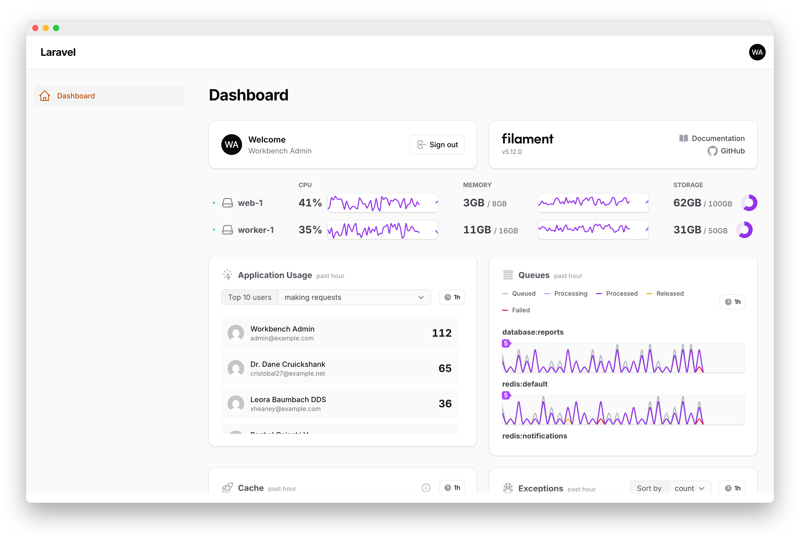
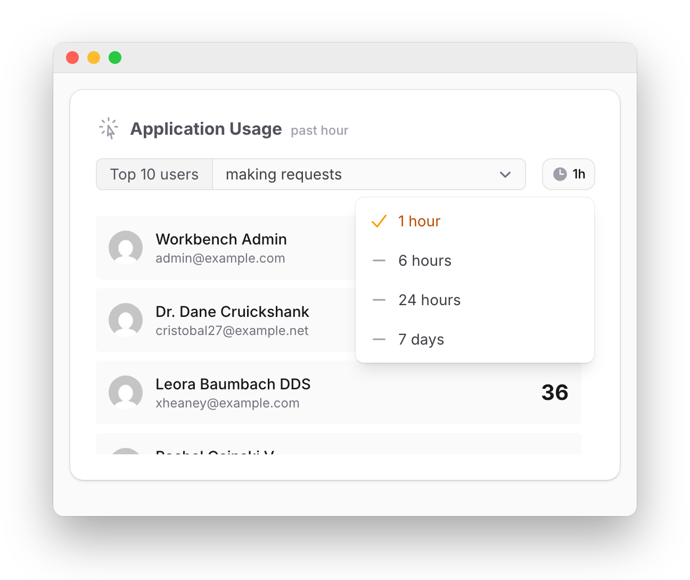

<!--
PROTOTYPE, throwaway (What does the README say, and with which screenshots?, #29).
Variant A: "The guide". One linear read, top to bottom: what it is, install, place, secure, customise, policy.
Images are relative here so the prototype renders on its branch; the real README needs absolute URLs.
-->

# Filament Pulse Widgets

[](https://packagist.org/packages/kfriars/filament-pulse-widgets)
[](https://github.com/kfriars/filament-pulse-widgets/actions)
[](LICENSE.md)

Laravel Pulse cards as Filament v5 widgets, alongside your panel's own widgets.

<picture>
  <source media="(prefers-color-scheme: dark)" srcset="screenshots/dashboard-dark-framed.png">
  
</picture>

Every first-party Pulse card ships as a ready-made **Pulse widget**, and any custom Pulse card can become one. A Pulse widget renders the real Pulse card, unchanged, styled to match your panel (light and dark), with its own period selector. It runs on official [`laravel/pulse`](https://github.com/laravel/pulse), not a fork, and needs no custom Filament theme.

## Requirements

- PHP 8.3+
- Laravel 12 or 13
- Filament 5.12+
- Laravel Pulse 1.11+, [installed and recording](https://laravel.com/docs/pulse#installation)

## Installation

1. Install the package:

   ```bash
   composer require kfriars/filament-pulse-widgets
   ```

2. Add the plugin to every panel that shows Pulse widgets:

   ```php
   use Kfriars\FilamentPulseWidgets\FilamentPulseWidgetsPlugin;

   public function panel(Panel $panel): Panel
   {
       return $panel
           // ...
           ->plugin(FilamentPulseWidgetsPlugin::make());
   }
   ```

   The plugin places nothing itself. It loads the Pulse widget stylesheet and Pulse's JavaScript on its panel only, and holds the panel's [access rules](#who-can-see-pulse-widgets).

3. Publish the assets:

   ```bash
   php artisan filament:assets
   ```

   If your app runs `php artisan filament:upgrade` after `composer update`, as Filament's install sets up, this already happens on every update.

> [!NOTE]
> Pulse's JavaScript loads as a module. If `ASSET_URL` points at another origin (a CDN), that origin must send CORS headers, as it already must for Vite's scripts.

## Placing Pulse widgets

A Pulse widget is a Filament widget. Put it anywhere a widget goes: a panel's `->widgets()`, a dashboard's `getWidgets()`, or a page's header or footer widgets.

```php
use Kfriars\FilamentPulseWidgets\Widgets\PulseServersWidget;
use Kfriars\FilamentPulseWidgets\Widgets\PulseSlowQueriesWidget;
use Kfriars\FilamentPulseWidgets\Widgets\PulseUsageWidget;

->widgets([
    PulseServersWidget::class,
    PulseUsageWidget::class,
    PulseSlowQueriesWidget::class,
])
```

### The ready-made Pulse widgets

| Pulse widget | Pulse card | Its own options |
| --- | --- | --- |
| `PulseServersWidget` | Servers | `->ignoreAfter()`, `->sortBy()`, `->sortDirection()` |
| `PulseUsageWidget` | Application Usage | `->type('requests' \| 'slow_requests' \| 'jobs')` |
| `PulseQueuesWidget` | Queues | |
| `PulseCacheWidget` | Cache | |
| `PulseExceptionsWidget` | Exceptions | |
| `PulseSlowQueriesWidget` | Slow Queries | `->withoutHighlighting()` |
| `PulseSlowRequestsWidget` | Slow Requests | |
| `PulseSlowJobsWidget` | Slow Jobs | |
| `PulseSlowOutgoingRequestsWidget` | Slow Outgoing Requests | |

Servers and Slow Queries span the full width by default.

### Options

Every option is set on `make()`, so the same Pulse widget can be placed twice with different options:

```php
use Kfriars\FilamentPulseWidgets\PulsePeriod;

PulseUsageWidget::make()->type('requests'),
PulseUsageWidget::make()->type('jobs')->period(PulsePeriod::SevenDays),
```

| Option | What it does |
| --- | --- |
| `->period(PulsePeriod::SixHours)` | The period it starts at, on every page load. Default: one hour. |
| `->withoutPeriodSelector()` | Hides the period selector, so it always shows the period it was placed with. |
| `->columnSpan(2)` | Filament's column span, for this placement. |
| `->expand()` | Grows the Pulse card to fit its content instead of scrolling it. |
| `->cardProperties([...])` | Props passed straight to the Pulse card, for anything without its own option. |
| `->authorize('ability')` | Gate abilities the user also needs. See [access](#who-can-see-pulse-widgets). |
| `->visible()` / `->hidden()` | Shows or hides the placement while the page renders. For layout, not security. |

### Your own Pulse cards

A [custom Pulse card](https://laravel.com/docs/pulse#custom-cards) needs no class of its own:

```php
use App\Livewire\Pulse\TopSellers;
use Kfriars\FilamentPulseWidgets\Widgets\PulseWidget;

PulseWidget::make()->card(TopSellers::class),
```

If you want a class, for its own [access rule](#who-can-see-pulse-widgets) or to place it by name, extend `PulseWidget` and set `$card`:

```php
class TopSellersWidget extends PulseWidget
{
    public string $card = TopSellers::class;
}
```

A custom Pulse card's own `css()` is loaded inside its Pulse widget. See [styling custom Pulse cards](#styling-custom-pulse-cards).

## Who can see Pulse widgets

By default, whoever passes Pulse's `viewPulse` gate.

> [!WARNING]
> Pulse's default `viewPulse` gate allows only the `local` environment. **In production, nobody sees Pulse widgets until you [define `viewPulse`](https://laravel.com/docs/pulse#dashboard-authorization)** or set a rule below.

> [!WARNING]
> Pulse widgets show **the whole app's** data: every user's requests, every slow query, every exception. That includes panels with tenancy. Don't give access to users who shouldn't see all of it.

Set a rule for the panel, which replaces `viewPulse` there (so you can show Pulse widgets without opening up `/pulse`):

```php
FilamentPulseWidgetsPlugin::make()
    ->authorize(fn (?User $user): bool => $user?->isAdmin() ?? false)
```

Or for particular Pulse widget classes, which takes precedence over the panel's rule:

```php
FilamentPulseWidgetsPlugin::make()
    ->authorize(fn (?User $user): bool => $user?->isAdmin() ?? false)
    ->authorize(fn (?User $user): bool => $user?->isSupport() ?? false, widgets: [
        PulseExceptionsWidget::class,
    ])
```

A placement can narrow its class's rule with gate abilities, checked again on every request its Pulse card makes:

```php
PulseSlowQueriesWidget::make()->authorize('view-database-internals'),
```

Users who aren't allowed don't see the Pulse widget at all. If they lose access while the page is open, the Pulse card's next poll gets a 403.

## The period selector

<picture>
  <source media="(prefers-color-scheme: dark)" srcset="screenshots/period-selector-dark-framed.png">
  
</picture>

Each Pulse widget has its own period selector in its Pulse card's header (Servers has none, as it has no header). It starts at the placement's `->period()` and resets on every page load.

To translate or reword its labels:

```bash
php artisan vendor:publish --tag=filament-pulse-widgets-translations
```

## Styling custom Pulse cards

First-party Pulse cards need nothing: the package ships their styles, scoped to `.fi-pulse-widget`. A custom Pulse card brings its own through `css()`, which arrives inside its Pulse widget.

If you followed [Pulse's Tailwind 4 recipe](https://laravel.com/docs/pulse#custom-card-styling-tailwind), two things differ from the panel:

- its `gray-*` classes use Tailwind's default grey, not the panel's;
- its theme variables land on `:root`, outside any layer, where they can override your custom theme's.

Import the theme as a reference and map the greys to the panel's:

```css
@import "tailwindcss/theme.css" theme(reference inline);

@theme inline reference {
    --color-gray-50: var(--gray-50);
    /* ...through... */
    --color-gray-950: var(--gray-950);
}
```

## Looking for a Pulse page?

This package doesn't add one: Pulse's own dashboard at `/pulse` already is one. To link to it from your panel's navigation, [filament-debugger](https://github.com/stephenjude/filament-debugger)'s `->pulseNavigation()` does that.

## Versioning and support

This package follows [semver](https://semver.org). It covers what this README documents:

- `FilamentPulseWidgetsPlugin`: `make()`, `get()`, `authorize()` and `ID`;
- every Pulse widget's `make()` options, `canView()`, and subclassing with `$card`;
- `PulsePeriod`;
- the translation keys;
- the `.fi-pulse-widget` class name.

Anything marked `@internal`, the views (including your overrides of published ones) and the stylesheet's contents may change in any release.

Laravel and PHP versions are dropped no earlier than their security end of life, and only in a minor release. Fixes go into the latest release only.

See [CHANGELOG.md](https://github.com/kfriars/filament-pulse-widgets/blob/master/CHANGELOG.md) for what changed.

## Security

Please report vulnerabilities privately, as [SECURITY.md](https://github.com/kfriars/filament-pulse-widgets/blob/master/.github/SECURITY.md) explains.

## Licence

MIT. See [LICENSE.md](LICENSE.md).
