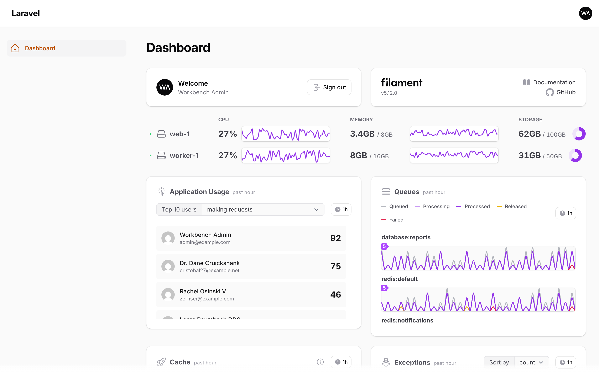
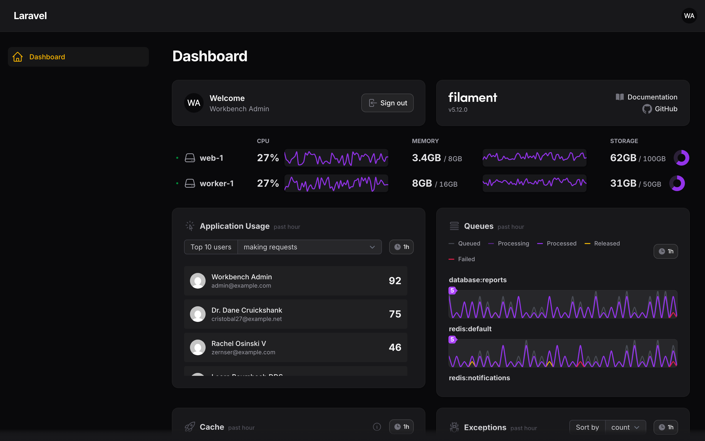
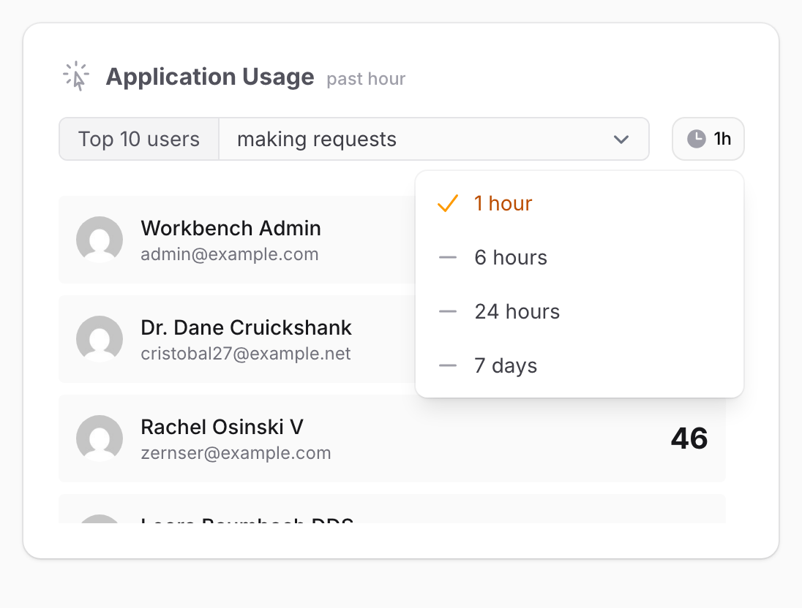

<!--
PROTOTYPE, throwaway (What does the README say, and with which screenshots?, #29).
Variant B: "Recipes". A short top (what, warnings, install), then one heading per thing a developer
wants to do, each a question with a snippet. Policy last. Light and dark shown side by side.
Images are relative here so the prototype renders on its branch; the real README needs absolute URLs.
-->

# Filament Pulse Widgets

**Laravel Pulse cards as Filament v5 widgets.** Put Servers, Slow Queries, Exceptions or your own Pulse cards on any Filament dashboard, next to your own widgets, looking like they belong there.

| Light | Dark |
| --- | --- |
|  |  |

Runs on official `laravel/pulse` 1.11+ (not a fork), Filament 5.12+, Laravel 12 or 13, PHP 8.3+. No custom theme needed.

> [!WARNING]
> **Two things to know before you ship it**
> - In production, nobody sees Pulse widgets until you [define Pulse's `viewPulse` gate](https://laravel.com/docs/pulse#dashboard-authorization), or [give the plugin a rule](#only-admins-should-see-pulse-widgets). Pulse's default allows only `local`.
> - Pulse widgets show **the whole app's** data, on every panel, tenancy or not.

## Install

```bash
composer require kfriars/filament-pulse-widgets
```

```php
// app/Providers/Filament/AdminPanelProvider.php
->plugin(\Kfriars\FilamentPulseWidgets\FilamentPulseWidgetsPlugin::make())
```

```bash
php artisan filament:assets   # filament:upgrade already runs this after composer update
```

Pulse itself must be [installed and recording](https://laravel.com/docs/pulse#installation).

## Recipes

### Put Pulse on my dashboard

```php
use Kfriars\FilamentPulseWidgets\Widgets;

->widgets([
    Widgets\PulseServersWidget::class,
    Widgets\PulseUsageWidget::class,
    Widgets\PulseQueuesWidget::class,
    Widgets\PulseCacheWidget::class,
    Widgets\PulseExceptionsWidget::class,
    Widgets\PulseSlowQueriesWidget::class,
    Widgets\PulseSlowRequestsWidget::class,
    Widgets\PulseSlowJobsWidget::class,
    Widgets\PulseSlowOutgoingRequestsWidget::class,
])
```

They're ordinary Filament widgets, so a page's `getHeaderWidgets()` works too.

### Show the last 24 hours of slow requests, half width

```php
use Kfriars\FilamentPulseWidgets\PulsePeriod;

PulseSlowRequestsWidget::make()
    ->period(PulsePeriod::TwentyFourHours)
    ->columnSpan(1),
```

The period resets to this on every page load. Add `->withoutPeriodSelector()` to pin it.

### Show only jobs in the Usage card

```php
PulseUsageWidget::make()->type('jobs'),
```

Each Pulse card's own options have a method: Usage `->type()`, Slow Queries `->withoutHighlighting()`, Servers `->ignoreAfter()`, `->sortBy()` and `->sortDirection()`, and `->expand()` on all but Servers. Anything else goes through `->cardProperties([...])`.

### Show my own Pulse card

```php
PulseWidget::make()->card(\App\Livewire\Pulse\TopSellers::class),
```

Its `css()` comes along. If you built it with Pulse's Tailwind 4 recipe, see [my custom card's greys look blue](#my-custom-pulse-cards-greys-dont-match-the-panel).

### Only admins should see Pulse widgets

```php
FilamentPulseWidgetsPlugin::make()
    ->authorize(fn (?User $user): bool => $user?->isAdmin() ?? false)
```

This replaces `viewPulse` on this panel, so `/pulse` stays as locked down as it was.

### Support can see Exceptions, but nothing else

```php
FilamentPulseWidgetsPlugin::make()
    ->authorize(fn (?User $user): bool => $user?->isAdmin() ?? false)
    ->authorize(fn (?User $user): bool => $user?->isSupport() ?? false, widgets: [PulseExceptionsWidget::class])
```

A rule for a class beats the panel's rule. To narrow one placement further, give it gate abilities: `PulseExceptionsWidget::make()->authorize('view-exceptions')`. They're re-checked on every poll. `->visible()` and `->hidden()` are only checked once, so use them for layout, never for security.

### My custom Pulse card's greys don't match the panel

Pulse's Tailwind 4 recipe compiles Tailwind's own grey, and puts its theme variables on `:root` where they can override your theme. Import the theme as a reference and point the greys at the panel's:

```css
@import "tailwindcss/theme.css" theme(reference inline);

@theme inline reference {
    --color-gray-50: var(--gray-50);
    /* ... */
    --color-gray-950: var(--gray-950);
}
```

### Rename "1h", "6h"... or translate them

```bash
php artisan vendor:publish --tag=filament-pulse-widgets-translations
```



### Serve assets from a CDN

Pulse's JavaScript loads as a module, so an `ASSET_URL` on another origin needs CORS headers.

### I wanted a whole Pulse page in my panel

Pulse's dashboard at `/pulse` is that page. [filament-debugger](https://github.com/stephenjude/filament-debugger)'s `->pulseNavigation()` links to it from your panel.

## What's stable

Semver covers the plugin (`make()`, `get()`, `authorize()`, `ID`), the Pulse widgets' `make()` options, `canView()` and subclassing with `$card`, `PulsePeriod`, the translation keys and the `.fi-pulse-widget` class. `@internal` code, the views and the stylesheet's contents can change in any release.

PHP and Laravel versions are dropped only after their security end of life, in a minor release. Fixes go into the latest release only. [Changelog](https://github.com/kfriars/filament-pulse-widgets/blob/master/CHANGELOG.md) · [Security](https://github.com/kfriars/filament-pulse-widgets/blob/master/.github/SECURITY.md) · [MIT licence](LICENSE.md)
