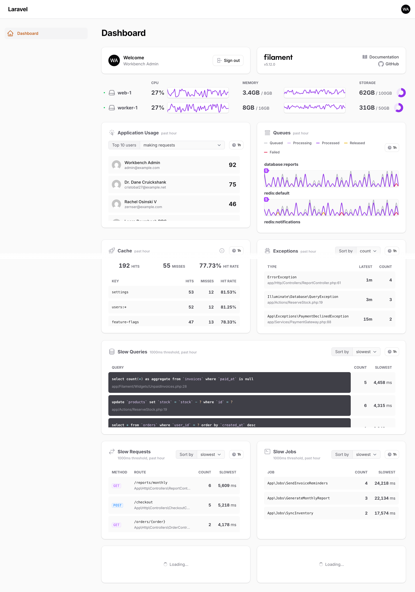

<!--
PROTOTYPE, throwaway (What does the README say, and with which screenshots?, #29).
Variant C: "Reference card". Almost no prose: one example, then everything in tables a reader scans.
One tall screenshot of every Pulse widget, light only, below the fold.
Images are relative here so the prototype renders on its branch; the real README needs absolute URLs.
-->

# Filament Pulse Widgets

Laravel Pulse cards as Filament v5 widgets.

```bash
composer require kfriars/filament-pulse-widgets
php artisan filament:assets
```

```php
use Kfriars\FilamentPulseWidgets\FilamentPulseWidgetsPlugin;
use Kfriars\FilamentPulseWidgets\PulsePeriod;
use Kfriars\FilamentPulseWidgets\Widgets\{PulseServersWidget, PulseUsageWidget, PulseWidget};

$panel
    ->plugin(FilamentPulseWidgetsPlugin::make())   // required on every panel with Pulse widgets
    ->widgets([
        PulseServersWidget::class,
        PulseUsageWidget::make()->type('jobs')->period(PulsePeriod::SevenDays),
        PulseWidget::make()->card(TopSellers::class),   // your own Pulse card
    ]);
```

| Requires | |
| --- | --- |
| PHP | 8.3+ |
| Laravel | 12, 13 |
| Filament | 5.12+ |
| Pulse | 1.11+ (official `laravel/pulse`, [installed](https://laravel.com/docs/pulse#installation)) |

## Pulse widgets

| Class | Pulse card | Default span | Period selector | Own options |
| --- | --- | --- | --- | --- |
| `PulseServersWidget` | Servers | full | no | `ignoreAfter()`, `sortBy()`, `sortDirection()` |
| `PulseUsageWidget` | Application Usage | 1 | yes | `type()`, `expand()` |
| `PulseQueuesWidget` | Queues | 1 | yes | `expand()` |
| `PulseCacheWidget` | Cache | 1 | yes | `expand()` |
| `PulseExceptionsWidget` | Exceptions | 1 | yes | `expand()` |
| `PulseSlowQueriesWidget` | Slow Queries | full | yes | `withoutHighlighting()`, `expand()` |
| `PulseSlowRequestsWidget` | Slow Requests | 1 | yes | `expand()` |
| `PulseSlowJobsWidget` | Slow Jobs | 1 | yes | `expand()` |
| `PulseSlowOutgoingRequestsWidget` | Slow Outgoing Requests | 1 | yes | `expand()` |
| `PulseWidget::make()->card(X::class)` | any custom Pulse card | 1 | if it has Pulse's card header | `expand()` |

## Options on every `make()`

| Option | Effect | Notes |
| --- | --- | --- |
| `period(PulsePeriod $period)` | Starting period | `OneHour` (default), `SixHours`, `TwentyFourHours`, `SevenDays`. Resets on page load. |
| `withoutPeriodSelector()` | No period selector | |
| `columnSpan($span)` | Filament column span | |
| `cardProperties(array $props)` | Props for the Pulse card | Every other option wins over these. |
| `authorize(string\|array $abilities)` | Extra gate abilities | Re-checked on every Pulse card request. |
| `visible($condition)` / `hidden($condition)` | Show or hide | Checked once, at render. **Not for security.** |

## Access

| Where | Write | Who sees it |
| --- | --- | --- |
| default | nothing | whoever passes Pulse's `viewPulse` gate (`local` only, until you define it) |
| plugin, whole panel | `->authorize(bool\|Closure)` | replaces `viewPulse` on that panel |
| plugin, some classes | `->authorize(bool\|Closure, widgets: [...])` | replaces the panel rule for exactly those classes |
| one placement | `X::make()->authorize('ability')` | the class rule **and** these abilities |

> **Pulse widgets show the whole app's data**, on every panel, tenancy included.

## Translations

`php artisan vendor:publish --tag=filament-pulse-widgets-translations`

| Key | English | Where |
| --- | --- | --- |
| `period-selector.period` | Period | menu label |
| `period-selector.short.*` | 1h, 6h, 24h, 7d | button |
| `period-selector.option.*` | 1 hour ... 7 days | menu |
| `period-selector.long.*` | past hour ... past 7 days | tooltip |

## Notes

- **Custom Pulse cards' CSS.** A card's `css()` loads inside its Pulse widget. Pulse's Tailwind 4 recipe gives it Tailwind's default grey and puts theme variables on `:root`; use `@import "tailwindcss/theme.css" theme(reference inline);` and an `@theme inline reference` block mapping `--color-gray-*` to `var(--gray-*)`.
- **CDN.** `pulse.js` is a module: a cross-origin `ASSET_URL` needs CORS headers.
- **No Pulse page.** Use `/pulse`; [filament-debugger](https://github.com/stephenjude/filament-debugger)'s `->pulseNavigation()` links to it.
- **Stability.** Semver covers what this README lists, plus `FilamentPulseWidgetsPlugin::get()`/`ID`, `canView()`, subclassing `PulseWidget` with `$card`, and `.fi-pulse-widget`. Not `@internal` code, views or stylesheet contents.
- **Support.** PHP/Laravel versions dropped only after security EOL, in a minor. Fixes in the latest release only.

[Changelog](https://github.com/kfriars/filament-pulse-widgets/blob/master/CHANGELOG.md) · [Security](https://github.com/kfriars/filament-pulse-widgets/blob/master/.github/SECURITY.md) · [MIT](LICENSE.md)


